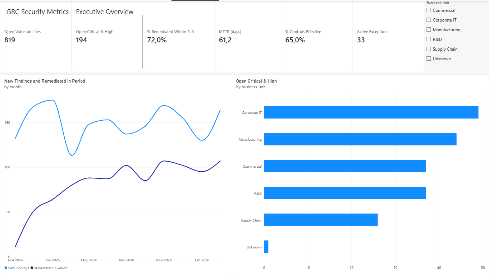
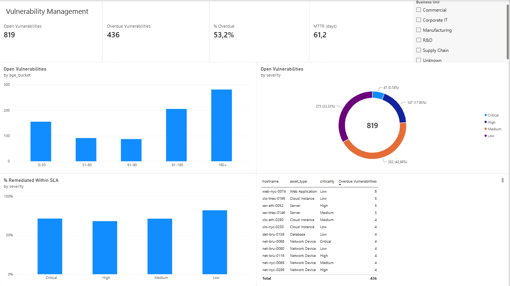
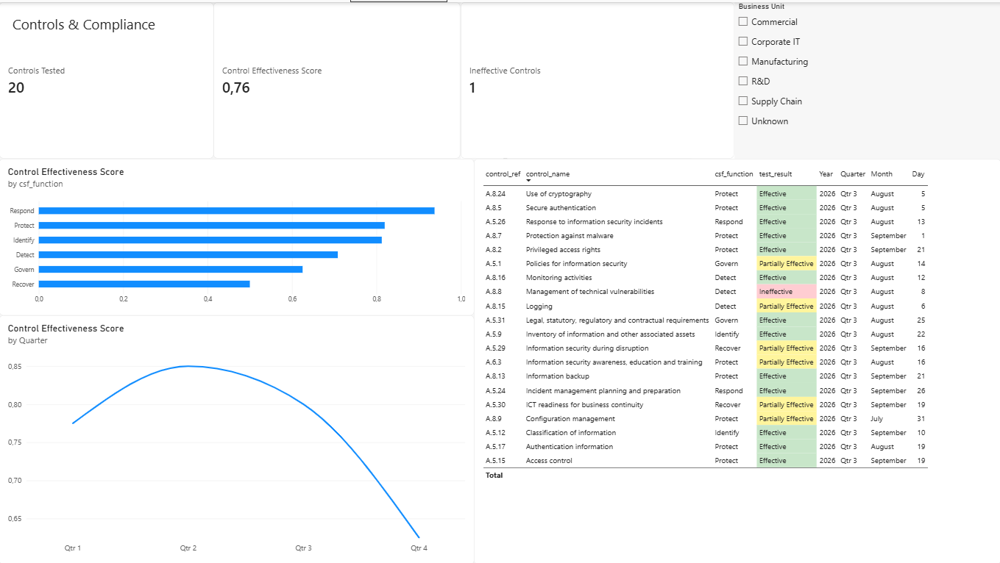
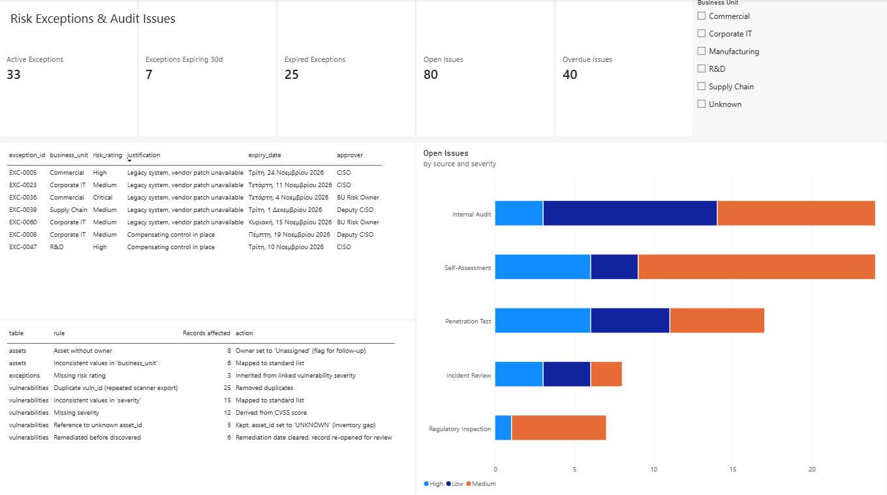

# GRC Security Metrics Dashboard

A Power BI dashboard that gives security leadership a single view of cyber risk and compliance:
vulnerability remediation against SLA, control effectiveness, risk exceptions and open audit issues.
A Python pipeline prepares the data automatically and logs every data quality fix, so the numbers
on the dashboard can be traced back to their source.

> All data is synthetic and generated by `scripts/generate_data.py`. It represents a fictional company.



## What it answers

| Question | Metric |
|---|---|
| How exposed are we right now? | Open vulnerabilities, open Critical & High, ageing buckets |
| Are we fixing things fast enough? | % remediated within SLA, MTTR, overdue findings |
| Are our controls working? | % controls effective (latest test), trend by quarter, by NIST CSF function |
| Where are we accepting risk? | Active exceptions, exceptions expiring in 30 days, expired exceptions |
| What did audit find and is it closed? | Open / overdue issues by source and business unit |

## How it works

```
raw extracts (CSV)  ->  prepare_data.py  ->  clean tables + data_quality_log  ->  export_excel.py  ->  Power BI
 asset inventory         validate              star-style model                  4 report pages
 vulnerability scan      clean                 date table                        DAX measures
 control tests           derive SLA fields
 exception register      log DQ issues
 issue tracker
```

**Data quality rules (automated)**

- Duplicate findings from repeated scanner exports are removed
- Severity values are mapped to a standard list; missing severity is derived from the CVSS score
- Remediation dates earlier than discovery dates are cleared and the finding is re-opened for review
- Findings that point to an asset missing from the inventory are kept and flagged as `UNKNOWN`
- Assets without an owner are flagged as `Unassigned`
- Each rule writes a line to `data_quality_log.csv`, which is shown on its own report page

**Remediation SLAs:** Critical 15 days, High 30, Medium 90, Low 180.
**Controls:** 20 controls from ISO/IEC 27001:2022 Annex A, grouped by NIST CSF 2.0 function.

## Report pages

1. **Executive Overview**: headline KPI cards, open vs remediated trend, risk by business unit
2. **Vulnerability Management**: severity breakdown, ageing, SLA performance, top overdue assets
3. **Controls & Compliance**: effectiveness by CSF function, quarterly trend, ineffective controls
4. **Exceptions & Issues**: active and expiring exceptions, open audit issues, data quality log

## Run it

```bash
pip install pandas numpy openpyxl
python scripts/generate_data.py    # creates data/raw/
python scripts/prepare_data.py     # creates data/clean/ and prints headline metrics
python scripts/export_excel.py     # bundles the clean tables into data/GRC_data.xlsx
```

Open `powerbi/GRC_Metrics_Dashboard.pbix`, point the data source to `data/GRC_data.xlsx`, and refresh.
A PDF export of the report is in `powerbi/GRC_Metrics_Dashboard.pdf` for viewing without Power BI.
DAX measures are in `powerbi/measures.dax`; metric definitions are in `docs/metric_definitions.md`.

## Screenshots

| Vulnerability Management | Controls & Compliance | Exceptions & Issues |
|---|---|---|
|  |  |  |

## Tools

Python (pandas, NumPy), Power BI (Power Query, DAX, data modelling), Git
